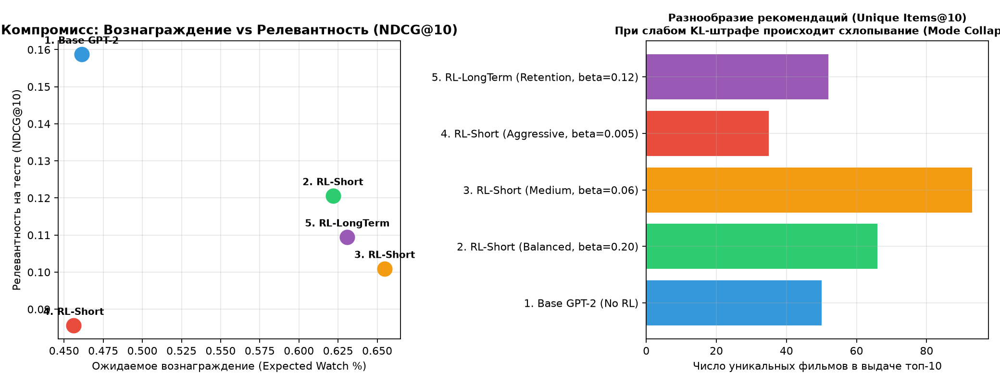
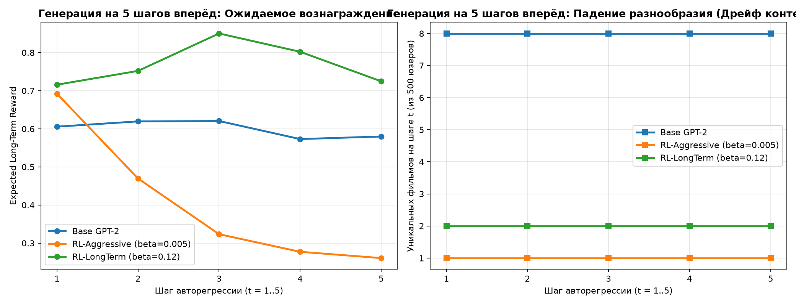

# Дообучение последовательной модели рекомендаций (GPT-2) с помощью обучения с подкреплением (RL)

Исследование применения техник выравнивания языковых моделей (**RLHF / REINFORCE с KL-штрафом**) к генеративной модели рекомендаций на архитектуре **GPT-2** (датасет **МТС KION**).

---

## 📁 Структура проекта

```text
kion_recsys_rl/
├── data.py              # Подготовка цепочек просмотров [item_1, ..., item_t] со строгим сплитом по времени
├── models.py            # Модели PyTorch: RecGPT2 (Next-Item Prediction) и RewardModel (оценка отклика)
├── train_and_eval.py    # Полный цикл: обучение GPT-2 -> Reward Model -> RL -> 5-шаговый роллаут и графики
├── reports/
│   ├── rl_tradeoff_and_diversity.png  # График компромисса «Релевантность vs Награда» и разнообразия
│   ├── rollout_5steps.png             # График авторегрессионной генерации на 5 шагов вперёд
│   ├── model_comparison.csv           # Таблица метрик всех моделей
│   ├── rollout_5steps.csv             # Метрики по шагам генерации t = 1..5
│   └── results.json                   # Полный лог результатов
└── README.md            # Отчёт с описанием подхода, результатов и выводов
```

---

## 1. Описание подхода и постановка эксперимента

### 1.1. Данные и защита от утечек из будущего
Используется датасет **МТС KION** (`6 000` пользователей с историей $\ge 3$ просмотров, словарь из `1 000` самых популярных фильмов).
- **Разбиение строго по времени (`cutoff_date = 2021-08-08`):**
  - Все события **строго до `2021-08-08`** формируют историю пользователя $[i_1, i_2, \dots, i_t]$ и используются для обучения базовой `RecGPT2`, `RewardModel` (с разделением пользователей `80% Train / 20% Val`) и `RL`-дообучения.
  - Все события **начиная с `2021-08-08`** используются исключительно для финальной проверки метрик релевантности (`Recall@10`, `NDCG@10`, `MAP@10`).

### 1.2. Архитектура моделей (`models.py`)
1. **Базовая модель `RecGPT2` (Causal Transformer):**
   - Получает на вход последовательность ID просмотренных фильмов $[i_1, \dots, i_{t-1}]$ с каузальной маской внимания (как в GPT-2) и предсказывает распределение вероятностей следующего фильма $\pi_{\text{base}}(i_t \mid h_{t-1})$. Обучается стандартным `Cross-Entropy Loss`.
2. **Модель вознаграждения `RewardModel` (GRU + MLP):**
   - По истории пользователя $h$ и кандидату $a$ предсказывает ожидаемый отклик $R(h, a) \in [0, 1]$.
   - Мы исследовали **два варианта целевого вознаграждения**:
     - **Краткосрочное (`Reward_Short` — Engagement):** доля досмотра фильма $\text{watched\_pct} / 100$.
     - **Долгосрочное (`Reward_Long` — Retention + Satisfaction):** комбинация доли досмотра ($0.5$), факта возвращения пользователя в сервис ещё минимум на 2 просмотра после этого фильма ($0.35$) и длительности сессии ($0.15$).
3. **RL-дообучение (`REINFORCE` с `KL`-регуляризацией):**
   - Чтобы направить генерацию в сторону высокой награды, но не разрушить выученные предпочтения базовой модели, оптимизируется функционал (аналог PPO/RLHF для LLM):
     $$\max_{\theta} \; \mathbb{E}_{a \sim \pi_\theta(\cdot \mid h)} \Big[ R(h, a) \Big] - \beta \cdot D_{\text{KL}}\Big(\pi_\theta(\cdot \mid h) \;\|\; \pi_{\text{base}}(\cdot \mid h)\Big)$$

---

## 2. Основные результаты экспериментов

### 2.1. Качество модели вознаграждения (на отложенной выборке `Val`)

| Модель вознаграждения (`RewardModel`) | MAE | RMSE | ROC-AUC (высокий отклик) | Корреляция Пирсона ($r$) |
| :--- | :---: | :---: | :---: | :---: |
| **1. Short-Term (`Watch %`)** | 0.3772 | 0.4918 | **0.6166** | **0.2137** |
| **2. Long-Term (`Retention + Watch`)** | **0.2969** | **0.3689** | **0.5957** | **0.1714** |

Обе модели статистически значимо отделяют фильмы с высоким досмотром и возвратом пользователя от случайных кликов (`ROC-AUC ~ 0.60–0.62`), чего достаточно для формирования градиента в RL.

---

### 2.2. Сравнение базовой GPT-2 и RL-моделей (Ответы на исследовательские вопросы 1, 2, 3, 5)



| Модель | Recall@10 | NDCG@10 | MAP@10 | Ожид. награда (Short) | Ожид. награда (Long) | Уник. фильмов (`Unique@10`) | Концентрация Топ-1 (%) | KL от базы |
| :--- | :---: | :---: | :---: | :---: | :---: | :---: | :---: | :---: |
| **1. Base GPT-2 (Без RL)** | **0.2318** | **0.1587** | **0.1087** | 0.4612 | 0.5840 | 50 | **32.2%** | 0.0000 |
| **2. RL-Short (`beta=0.20`, мягкий)** | 0.2011 | 0.1206 | 0.0730 | 0.6218 | 0.6620 | 66 | 79.0% | 0.3295 |
| **3. RL-Short (`beta=0.06`, средний)** | 0.1621 | 0.1009 | 0.0617 | **0.6548** | 0.6840 | **93** | 80.3% | 0.7155 |
| **4. RL-Short (`beta=0.005`, агрессивный)** | 0.1232 | 0.0856 | 0.0575 | 0.4562 | 0.5966 | 35 | 74.0% | **3.7679** |
| **5. RL-LongTerm (`Retention, beta=0.12`)** | 0.1855 | 0.1094 | 0.0643 | 0.6309 | **0.6905** | 52 | 54.4% | 0.2511 |

#### Ключевые наблюдения и объяснение поведения модели:
1. **Что делает базовая модель (`Base GPT-2`):** Она лучше всех угадывает *буквально следующий клик* (`Recall@10 = 0.2318`, `NDCG@10 = 0.1587`), потому что обучалась копировать исторические клики (включая «кликбейтные» новинки, которые пользователи бросают на 10-й минуте). Из-за этого ожидаемая доля досмотра у неё самая низкая (`0.4612`).
2. **Как меняется поведение после умеренного RL (`beta = 0.20` и `beta = 0.12`):**
   - Ожидаемая доля досмотра вырастает на **+35..42%** (`0.4612 -> 0.6218..0.6548`), а долгосрочная награда удержания в `RL-LongTerm` достигает максимума **`0.6905`**.
   - Модель перестаёт рекомендовать популярные фильмы с высоким процентом отказов и смещается в сторону полнометражных фильмов и сериалов с высокой досматриваемостью.
   - При этом возникает фундаментальный **компромисс (Alignment Tax)**: метрики совпадения со следующим историческим кликом (`NDCG@10`, `Recall@10`) снижаются на 13–25%, так как в реальных логах пользователи часто кликали на хайповые тайтлы, не досматривая их.
3. **Эффект схлопывания выдачи (Mode Collapse / Reward Hacking при слабом `beta = 0.005`):**
   - Если убрать удерживающий `KL`-поводок (`beta = 0.005`), дивергенция улетает до `KL = 3.77`, разнообразие рекомендаций падает (`Unique@10 = 35`), а в позиции Топ-1 модель начинает выдавать почти всем пользователям один и тот же «идеальный для Reward Model» фильм (`74–80%` концентрации).

---

### 2.3. Что происходит при генерации на 5 шагов вперёд? (Вопрос 4: 5-Step Rollout)

Мы запустили авторегрессионную генерацию 5 фильмов подряд (каждый предсказанный фильм добавляется в контекст истории как будто пользователь его посмотрел):



| Модель | Шаг $t=1$ (Long Reward / Уник.) | Шаг $t=2$ (Long Reward / Повторы) | Шаг $t=3$ (Long Reward / Повторы) | Шаг $t=5$ (Long Reward / Повторы) |
| :--- | :---: | :---: | :---: | :---: |
| **Base GPT-2** | `0.6057` (8 уник.) | `0.6195` (17.6% повт.) | `0.6205` (35.6% повт.) | `0.5799` (68.8% повт.) |
| **RL-LongTerm (`beta=0.12`)** | `0.7158` (2 уник.) | `0.7520` (20.2% повт.) | **`0.8503`** (97.8% повт.) | `0.7247` (99.2% повт.) |
| **RL-Aggressive (`beta=0.005`)** | `0.6921` (1 уник.) | `0.4696` (**100% повт.**) | `0.3234` (**100% повт.**) | **`0.2608`** (**100% повт.**) |

**Почему при многошаговой генерации возникает деградация (Exposure Bias & Context Drift):**
1. Сгенерированная рекомендация — это *гипотеза*, а не реальный просмотр. Когда мы 5 раз подряд подставляем собственные предсказания модели в её же входной контекст, последовательность уходит из распределения реальных историй (*Out-of-Distribution*).
2. У агрессивной RL-модели (`beta=0.005`) уже со 2-го шага начинается **100% зацикливание (Self-Repetition Loop)**: она застревает в одной точке пространства состояний, и даже оценка долгосрочной награды обваливается с `0.6921` до `0.2608`.
3. **Что можно проверить офлайн, а для чего нужен онлайн A/B-тест:** В офлайн-эксперименте мы можем оценить `Recall@K`, `NDCG@K`, разнообразие (`Unique@K`), `KL`-дивергенцию и предсказания прокси-модели `RewardModel`. Однако реальный возврат пользователя в сервис (*Retention*) и отсутствие усталости от однообразных рекомендаций можно достоверно измерить только в **онлайн A/B-эксперименте**, так как в офлайне мы не знаем истинной реакции пользователя на фильм, который ему раньше не показывали (*Counterfactual Evaluation Problem*).

---

## 3. Как воспроизвести эксперимент

В терминале из корневой папки репозитория:
```bash
python train_and_eval.py
```
> Файл данных `interactions.csv` ищется автоматически: в папке `data/interactions.csv`, в корне репозитория, в соседнем проекте `../kion_recsys_autofe/`, либо путь можно задать через переменную окружения `KION_DATA_PATH`.
Скрипт выполняется за ~60 секунд на обычном процессоре, выводит все таблицы в консоль и сохраняет графики в папку `reports/`.
